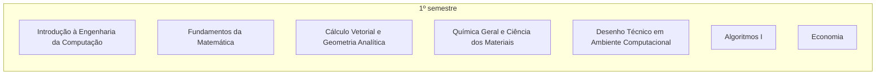

# 📅 1º semestre · 2024/2 ✅

  

[🏠 Início](../README.md) · [2º semestre →](../02-semestre/README.md)

| Status | Código | Disciplina | Carga horária | Núcleo |
| :---: | --- | --- | --- | --- |
| ✅ | ENC-01 | 📝 [Introdução à Engenharia da Computação](intro-eng-computacao/README.md) | 34 h | — |
| ✅ | ENC-02 | ➗ [Fundamentos da Matemática](fundamentos-matematica/README.md) | 68 h | Básico |
| ✅ | ENC-03 | ➗ [Cálculo Vetorial e Geometria Analítica](calculo-vetorial-ga/README.md) | 68 h | Básico |
| ✅ | ENC-04 | 🧪 [Química Geral e Ciência dos Materiais](quimica-geral-ciencia-materiais/README.md) | 34 h | Básico |
| ✅ | ENC-05 | 📐 [Desenho Técnico em Ambiente Computacional](desenho-tecnico-computacional/README.md) | 34 h | Básico |
| ✅ | ENC-06 | 💻 [Algoritmos I](algoritmos-i/README.md) | 68 h | Básico |
| ✅ | ENC-07 | 📈 [Economia](economia/README.md) | 34 h | Básico |

**Total:** 340 h · teórica 306 h · prática 34 h · extensão 0 h

> [!NOTE]
> Período calculado pelo fluxo regular do curso (2024/2); ajuste se cursou ou for cursar em outro período.

## 🔗 Pré-requisitos

