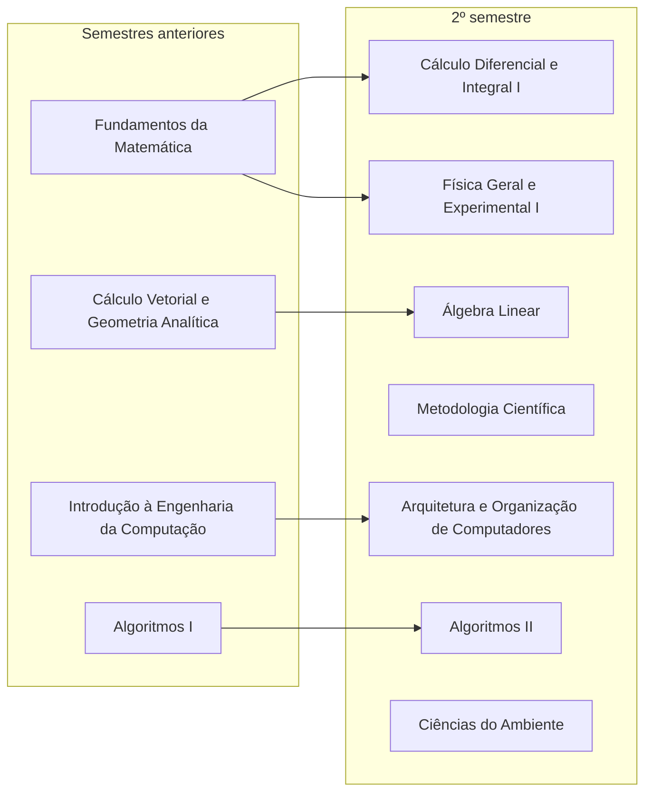

# 📅 2º semestre · 2025/1 ✅

  

[🏠 Início](../README.md) · [← 1º semestre](../01-semestre/README.md) · [3º semestre →](../03-semestre/README.md)

| Status | Código | Disciplina | Carga horária | Núcleo |
| :---: | --- | --- | --- | --- |
| ✅ | ENC-08 | ➗ [Cálculo Diferencial e Integral I](calculo-i/README.md) | 68 h | Básico |
| ✅ | ENC-09 | ⚛️ [Física Geral e Experimental I](fisica-i/README.md) | 68 h | Básico |
| ✅ | ENC-10 | ➗ [Álgebra Linear](algebra-linear/README.md) | 68 h | Básico |
| ✅ | ENC-11 | 📝 Metodologia Científica ¹ | 34 h | Básico |
| ✅ | ENC-12 | 🖥️ [Arquitetura e Organização de Computadores](arquitetura-organizacao-computadores/README.md) | 68 h | Profissionalizante |
| ✅ | ENC-13 | 💻 [Algoritmos II](algoritmos-ii/README.md) | 68 h | Profissionalizante |
| ✅ | ENC-14 | 🌱 Ciências do Ambiente ¹ | 34 h | Básico |

¹ Formação geral, sem pasta: o foco deste repositório é computação, física e matemática.

**Total:** 408 h · teórica 323 h · prática 68 h · extensão 17 h

> [!NOTE]
> Período calculado pelo fluxo regular do curso (2025/1); ajuste se cursou ou for cursar em outro período.

## 🔗 Pré-requisitos

