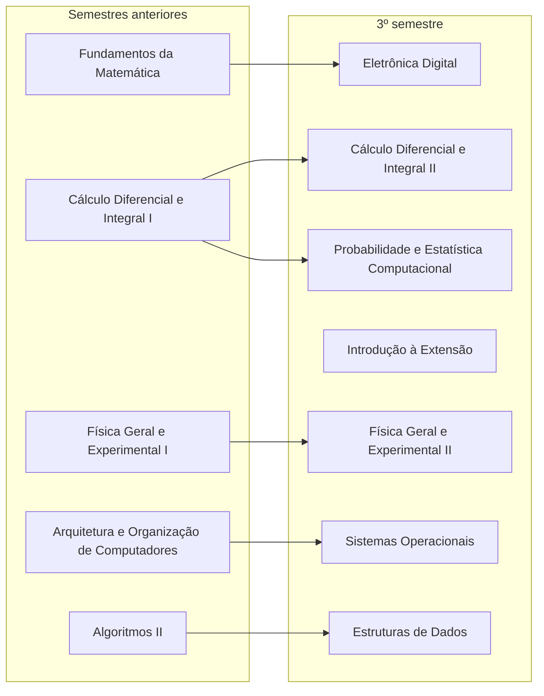

# 📅 3º semestre · 2025/2 ✅

  

[🏠 Início](../README.md) · [← 2º semestre](../02-semestre/README.md) · [4º semestre →](../04-semestre/README.md)

| Status | Código | Disciplina | Carga horária | Núcleo |
| :---: | --- | --- | --- | --- |
| ✅ | ENC-15 | ➗ [Cálculo Diferencial e Integral II](calculo-ii/README.md) | 68 h | Básico |
| ✅ | ENC-16 | ⚛️ [Física Geral e Experimental II](fisica-ii/README.md) | 68 h | Básico |
| ✅ | ENC-17 | 🔌 [Eletrônica Digital](eletronica-digital/README.md) | 68 h | Básico |
| ✅ | ENC-18 | 🤝 Introdução à Extensão ¹ | 34 h | — |
| ✅ | ENC-19 | 🖥️ [Sistemas Operacionais](sistemas-operacionais/README.md) | 68 h | Profissionalizante |
| ✅ | ENC-20 | 💻 [Estruturas de Dados](estrutura-dados/README.md) | 68 h | Profissionalizante |
| ✅ | ENC-21 | 📊 [Probabilidade e Estatística Computacional](probabilidade-estatistica-computacional/README.md) | 34 h | Específico |

¹ Formação geral, sem pasta: o foco deste repositório é computação, física e matemática.

**Total:** 408 h · teórica 282 h · prática 92 h · extensão 34 h

> [!NOTE]
> Período calculado pelo fluxo regular do curso (2025/2); ajuste se cursou ou for cursar em outro período.

## 🔗 Pré-requisitos

