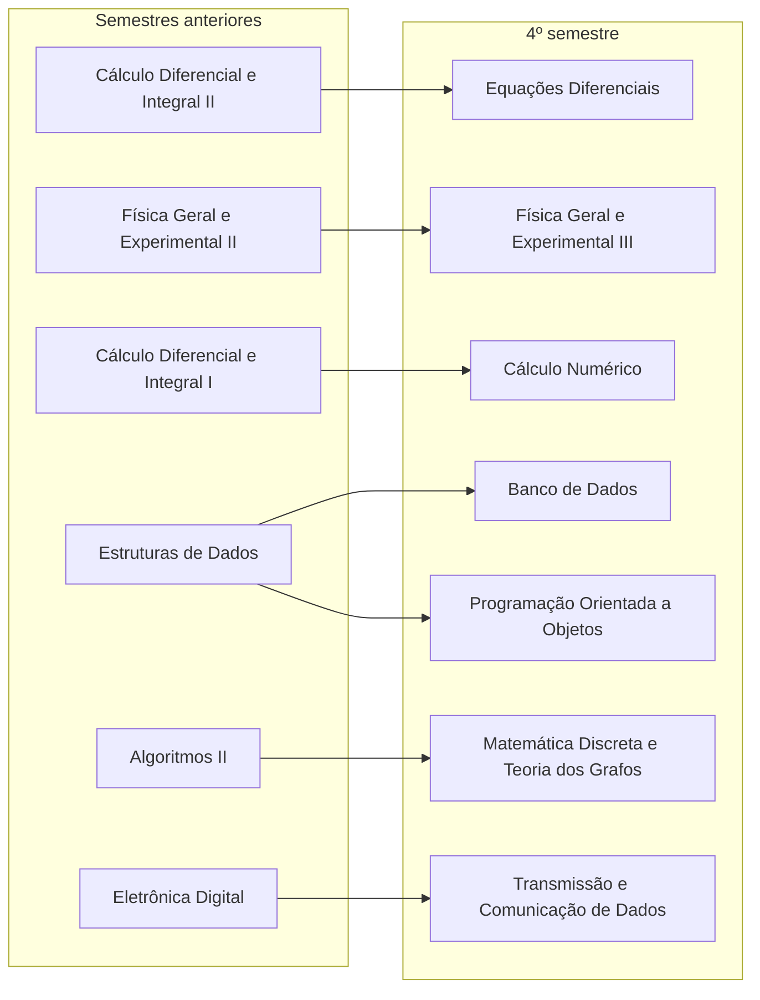

# 📅 4º semestre · 2026/1 ✅

  

[🏠 Início](../README.md) · [← 3º semestre](../03-semestre/README.md) · [5º semestre →](../05-semestre/README.md)

| Status | Código | Disciplina | Carga horária | Núcleo |
| :---: | --- | --- | --- | --- |
| ✅ | ENC-22 | ➗ [Equações Diferenciais](equacoes-diferenciais/README.md) | 68 h | Básico |
| ✅ | ENC-23 | ⚛️ [Física Geral e Experimental III](fisica-iii/README.md) | 68 h | Básico |
| ✅ | ENC-24 | ➗ [Cálculo Numérico](calculo-numerico/README.md) | 68 h | Profissionalizante |
| ✅ | ENC-25 | 🗄️ [Banco de Dados](banco-dados/README.md) | 68 h | Específico |
| ✅ | ENC-26 | 💻 [Programação Orientada a Objetos](programacao-orientada-objetos/README.md) | 68 h | Profissionalizante |
| ✅ | ENC-27 | ➗ [Matemática Discreta e Teoria dos Grafos](matematica-discreta-grafos/README.md) | 34 h | Profissionalizante |
| ✅ | ENC-28 | 🔌 [Transmissão e Comunicação de Dados](transmissao-comunicacao-dados/README.md) | 68 h | Específico |

**Total:** 442 h · teórica 357 h · prática 85 h · extensão 0 h

> [!NOTE]
> Período calculado pelo fluxo regular do curso (2026/1); ajuste se cursou ou for cursar em outro período.

## 🔗 Pré-requisitos

