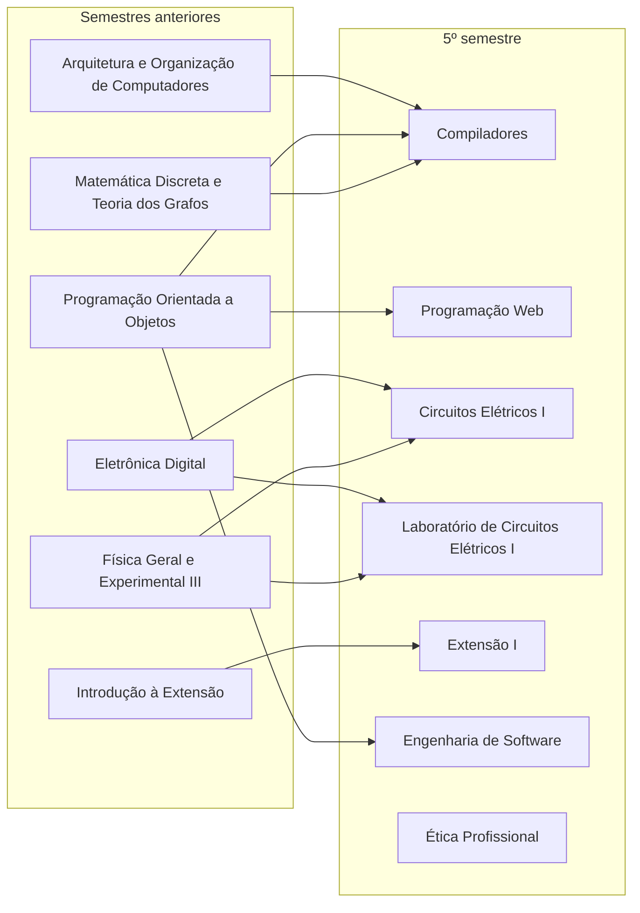

# 📅 5º semestre · 2026/2 🚧

  

[🏠 Início](../README.md) · [← 4º semestre](../04-semestre/README.md) · [6º semestre →](../06-semestre/README.md)

| Status | Código | Disciplina | Carga horária | Núcleo |
| :---: | --- | --- | --- | --- |
| 🚧 | ENC-29 | 🧩 [Compiladores](compiladores/README.md) | 68 h | Específico |
| 🚧 | ENC-30 | 🌐 [Programação Web](programacao-web/README.md) | 68 h | Específico |
| 🚧 | ENC-31 | 🔌 [Circuitos Elétricos I](circuitos-eletricos-i/README.md) | 68 h | Básico |
| 🚧 | ENC-32 | 🔌 [Laboratório de Circuitos Elétricos I](lab-circuitos-eletricos-i/README.md) | 34 h | Básico |
| 🚧 | ENC-33 | 🤝 [Extensão I](extensao-i/README.md) | 102 h | — |
| 🚧 | ENC-34 | 🏗️ [Engenharia de Software](engenharia-software/README.md) | 68 h | Específico |
| 🚧 | ENC-35 | 📝 [Ética Profissional](etica-profissional/README.md) | 34 h | Básico |

**Total:** 442 h · teórica 207 h · prática 102 h · extensão 133 h

## 🔗 Pré-requisitos

