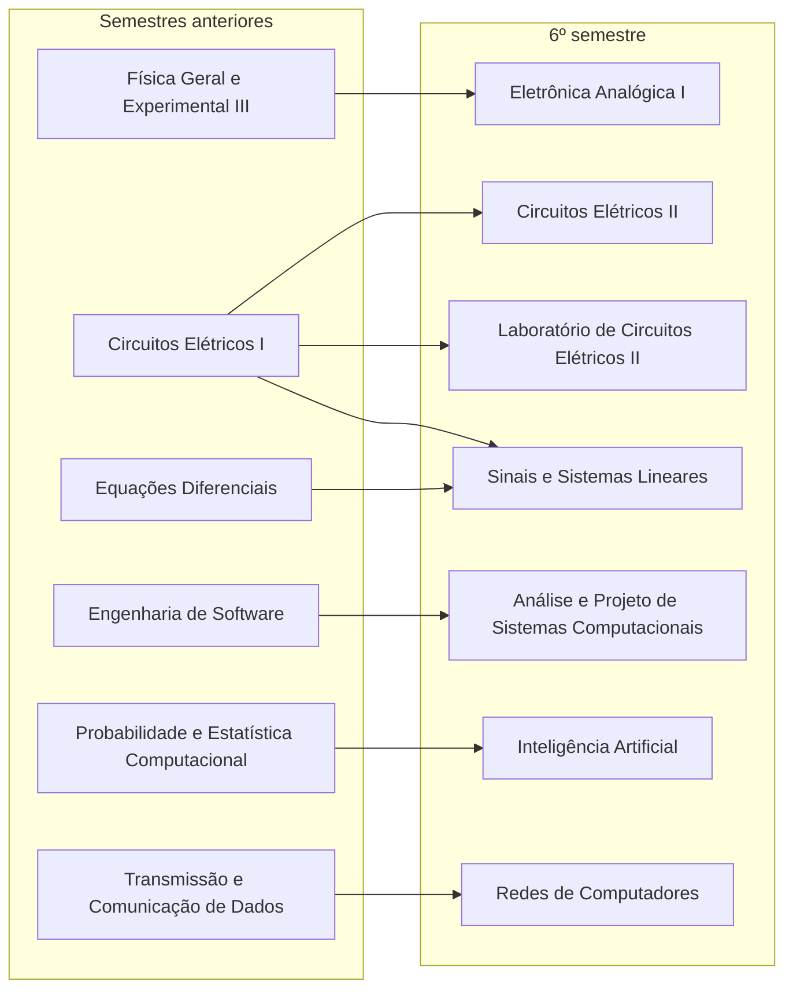

# 📅 6º semestre · 2027/1 ⏳

  

[🏠 Início](../README.md) · [← 5º semestre](../05-semestre/README.md) · [7º semestre →](../07-semestre/README.md)

| Status | Código | Disciplina | Carga horária | Núcleo |
| :---: | --- | --- | --- | --- |
| ⏳ | ENC-36 | 🔌 [Eletrônica Analógica I](eletronica-analogica-i/README.md) | 68 h | Profissionalizante |
| ⏳ | ENC-37 | 🔌 [Circuitos Elétricos II](circuitos-eletricos-ii/README.md) | 68 h | Profissionalizante |
| ⏳ | ENC-38 | 🔌 [Laboratório de Circuitos Elétricos II](lab-circuitos-eletricos-ii/README.md) | 34 h | Profissionalizante |
| ⏳ | ENC-39 | ➗ [Sinais e Sistemas Lineares](sinais-sistemas-lineares/README.md) | 68 h | Específico |
| ⏳ | ENC-40 | 🏗️ [Análise e Projeto de Sistemas Computacionais](analise-projeto-sistemas-computacionais/README.md) | 68 h | Específico |
| ⏳ | ENC-41 | 🤖 [Inteligência Artificial](inteligencia-artificial/README.md) | 68 h | Específico |
| ⏳ | ENC-42 | 🌐 [Redes de Computadores](rede-computadores/README.md) | 68 h | Específico |

**Total:** 442 h · teórica 326 h · prática 102 h · extensão 14 h

> [!NOTE]
> Período calculado pelo fluxo regular do curso (2027/1); ajuste se cursou ou for cursar em outro período.

## 🔗 Pré-requisitos

