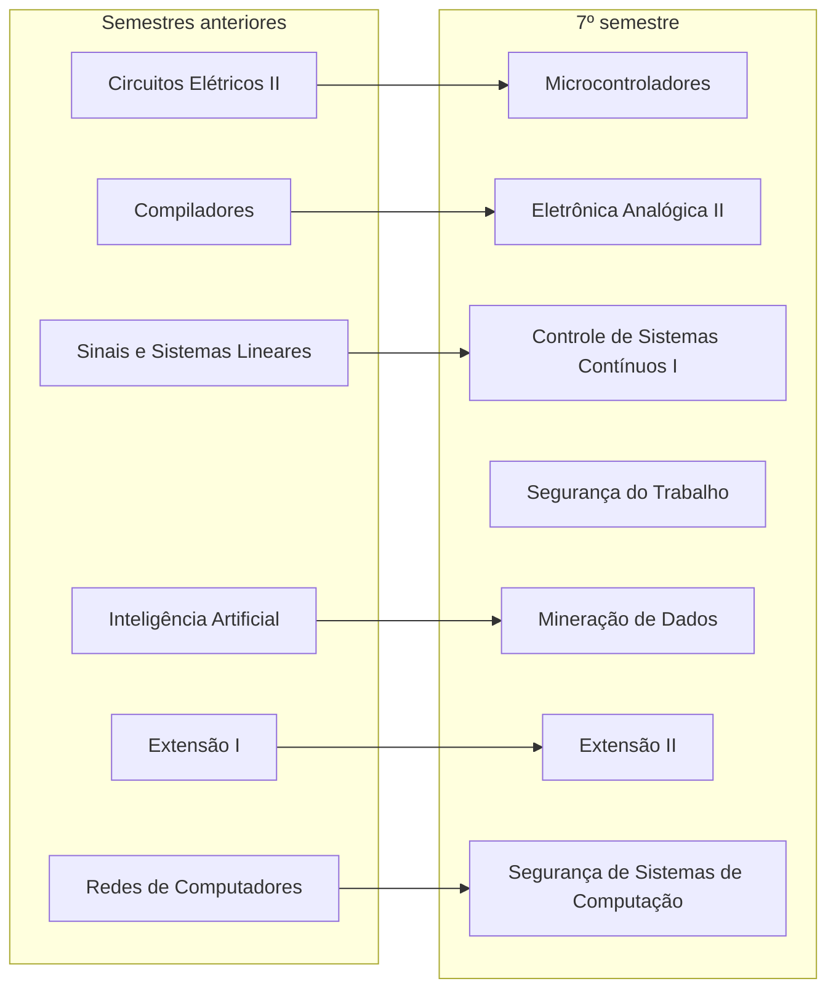

# 📅 7º semestre · 2027/2 ⏳

  

[🏠 Início](../README.md) · [← 6º semestre](../06-semestre/README.md) · [8º semestre →](../08-semestre/README.md)

| Status | Código | Disciplina | Carga horária | Núcleo |
| :---: | --- | --- | --- | --- |
| ⏳ | ENC-43 | 🔧 [Microcontroladores](microcontroladores/README.md) | 68 h | Profissionalizante |
| ⏳ | ENC-44 | 🔌 [Eletrônica Analógica II](eletronica-analogica-ii/README.md) | 68 h | Profissionalizante |
| ⏳ | ENC-45 | ➗ [Controle de Sistemas Contínuos I](controle-sistemas-continuos-i/README.md) | 68 h | Profissionalizante |
| ⏳ | ENC-46 | 🦺 [Segurança do Trabalho](seguranca-trabalho/README.md) | 34 h | Profissionalizante |
| ⏳ | ENC-47 | ⛏️ [Mineração de Dados](mineracao-dados/README.md) | 68 h | Específico |
| ⏳ | ENC-48 | 🤝 [Extensão II](extensao-ii/README.md) | 102 h | — |
| ⏳ | ENC-49 | 🔒 [Segurança de Sistemas de Computação](seguranca-sistemas-computacao/README.md) | 34 h | Específico |

**Total:** 442 h · teórica 234 h · prática 75 h · extensão 133 h

> [!NOTE]
> Período calculado pelo fluxo regular do curso (2027/2); ajuste se cursou ou for cursar em outro período.

## 🔗 Pré-requisitos

