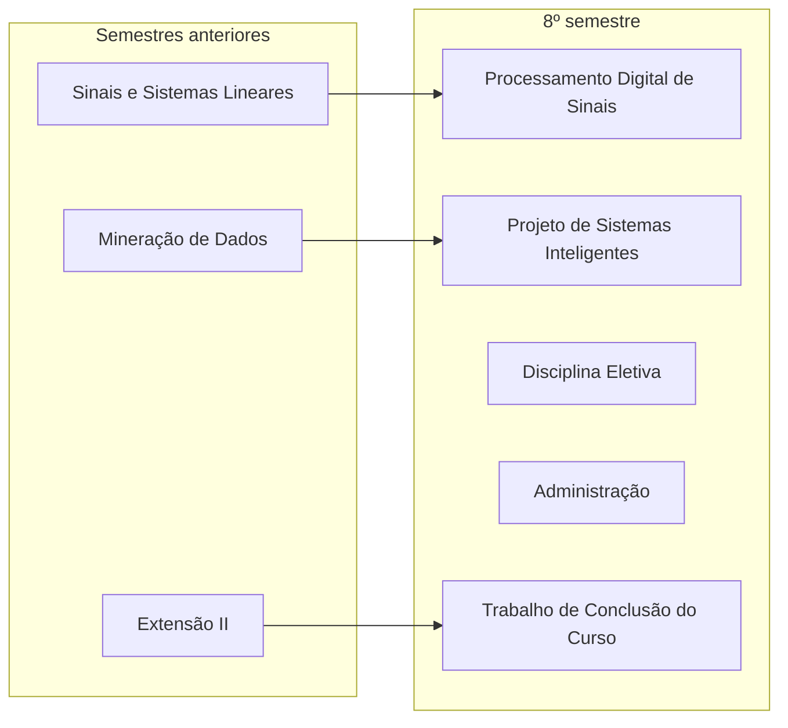

# 📅 8º semestre · 2028/1 ⏳

  

[🏠 Início](../README.md) · [← 7º semestre](../07-semestre/README.md)

| Status | Código | Disciplina | Carga horária | Núcleo |
| :---: | --- | --- | --- | --- |
| ⏳ | ENC-50 | ➗ [Processamento Digital de Sinais](processamento-digital-sinais/README.md) | 34 h | Específico |
| ⏳ | ENC-51 | 🧠 [Projeto de Sistemas Inteligentes](projeto-sistemas-inteligentes/README.md) | 68 h | Específico |
| ⏳ | ENC-52 | 🎯 [Disciplina Eletiva](eletiva/README.md) | 34 h | — |
| ⏳ | ENC-53 | 🏢 [Administração](administracao/README.md) | 34 h | Básico |
| ⏳ | ENC-54 | 🎓 [Trabalho de Conclusão do Curso](tcc/README.md) | 34 h | — |

**Total:** 204 h · teórica 156 h · prática 34 h · extensão 14 h

> [!NOTE]
> Período calculado pelo fluxo regular do curso (2028/1); ajuste se cursou ou for cursar em outro período.

## 🔗 Pré-requisitos

